<div align="center">



**راه‌اندازی خودکار · تنظیم شبکه · کنترل دسترسی · بازیابی**

[شروع سریع](#شروع) · [قابلیت‌ها](#قابلیتها) · [تلگرام سازنده](https://t.me/talktosunix)

</div>

---

# Sudex

**ابزار سبک و یکپارچهٔ بهینه‌سازی سرورهای DNS**

**Sudex**، ساختهٔ [TalkToSunix](https://github.com/TalkToSunix)، ابزاری مستقل برای آماده‌سازی، تنظیم و بهینه‌سازی زیرساخت DNS روی سرورهای اوبونتو است؛ با تمرکز بر عملکرد، پایداری و کنترل دسترسی.

راه‌اندازی خودکار، تنظیم شبکه، مدیریت سرویس، فایروال، پشتیبان‌گیری و بررسی سلامت سرور، همگی از یک محیط ترمینالی در دسترس‌اند. هدف Sudex، ساده‌کردن مدیریت زیرساخت DNS با کمترین پیچیدگی و سربار است.

در نسخهٔ فعلی، Sudex با AdGuard Home نصب و تنظیم‌شده کار می‌کند. برای اجرای عملیات، گزینهٔ **Install all** را انتخاب کنید.

> نسخهٔ آزمایشی 0.1.0 — بررسی‌های محلی انجام شده‌اند؛ نصب کامل روی VPS اوبونتو و آزمون راه‌اندازی مجدد هنوز انجام نشده است. ابتدا روی سرور آزمایشی با دسترسی کنسول ارائه‌دهنده اجرا کنید.

## شروع

روی سرور مقصد اجرا کنید (وجود `curl` یا `wget` برای دریافت فایل لازم است):

```bash
curl -fL --proto '=https' --tlsv1.2 https://raw.githubusercontent.com/TalkToSunix/sudex/main/install.sh -o sudex.sh && sudo bash sudex.sh
```

گزینهٔ `1) Install all` را انتخاب کنید. برای دسترسی از دستگاه‌های دیگر، IP یا شبکهٔ دستگاه‌های مجاز را وارد کنید؛ با خالی گذاشتن این بخش، DNS فقط برای استفادهٔ محلی در فایروال مجاز خواهد بود. مقادیر نمونه را با IP واقعی خودتان جایگزین کنید.

اگر curl نصب نیست:

```bash
wget https://raw.githubusercontent.com/TalkToSunix/sudex/main/install.sh -O sudex.sh && sudo bash sudex.sh
```

## قابلیت‌ها

| بخش | عملکرد |
| --- | --- |
| ابزارها | curl، ca-certificates، jq، ufw، ethtool، dnsutils، iproute2، unattended-upgrades، apt-listchanges |
| سرویس | ساخت سرویس AdGuardHome در صورت نبودن، شروع خودکار و restart پس از خطا |
| DNS میزبان | آزادسازی DNSStubListener و تغییر resolver به 127.0.0.1 فقط پس از پاسخ موفق AdGuard |
| شبکه | فعال‌سازی BBR، FQ و TCP Fast Open در صورت پشتیبانی کرنل |
| فایروال | حفظ پورت SSH تشخیص‌داده‌شده، محدودسازی TCP/UDP 53 به کلاینت‌های مشخص، فعال‌سازی UFW برای IPv4/IPv6 |
| نگهداری | فعال‌سازی unattended upgrades طبق سیاست موجود اوبونتو و NTP در صورت امکان |
| گزارش | وضعیت سرویس، پاسخ DNS محلی و روی IPهای واقعی سرور، فایروال و تنظیمات شبکه |
| بازیابی | نسخهٔ پشتیبان از فایل‌های تغییرکرده و تلاش برای بازگردانی آن‌ها هنگام خطا |

این ابزار upstreamها، رمز مدیریت، DNSSEC، کش یا تنظیمات YAML خود AdGuard را تغییر نمی‌دهد. BBR و TCP Fast Open ویژگی‌های TCP هستند و تضمینی برای افزایش سرعت همهٔ درخواست‌های DNS، خصوصاً UDP، ایجاد نمی‌کنند.

## پیش‌نیازها و محدودهٔ نسخهٔ اول

- میزبان اختصاصی Ubuntu **22.04 یا 24.04** با systemd و دسترسی root؛ این‌ها اهداف پشتیبانی هستند، نه سیستم‌های تست‌شدهٔ این انتشار.
- `python3`، `ip`، `ss`، `flock`، `timeout` و ابزارهای پایهٔ اوبونتو باید موجود باشند.
- AdGuard در `/opt/AdGuardHome/AdGuardHome` و فایل پیکربندی معتبر در `/opt/AdGuardHome/AdGuardHome.yaml`.
- AdGuard باید روی `127.0.0.1:53` پاسخ بدهد. اگر این آزمون شکست بخورد، تغییر resolver نهایی نمی‌شود و بازیابی اجرا خواهد شد.
- UFW باید غیرفعال باشد. Docker، firewalld و سرویس nftables فعال پشتیبانی نمی‌شوند. قوانین دستی nftables/iptables و فایروال‌های خارج از میزبان باید جداگانه بررسی شوند.
- سرویس‌های دیگر مانند وب‌سرور ممکن است پس از فعال‌شدن UFW به قانون ورودی نیاز داشته باشند. این ابزار برای سرور اختصاصی DNS طراحی شده است.
- پورت SSH از نشست فعلی تشخیص داده می‌شود؛ در کنسول، یک پورت مشخص در پیکربندی sshd باید قابل تشخیص و در حال listen باشد.
- پیکربندی سفارشی سرویس AdGuard با مسیرهای متفاوت پذیرفته نمی‌شود.
- شبکه‌های نامحدود `/0` پذیرفته نمی‌شوند. این نسخه برای انتشار DNS عمومی بدون محدودیت طراحی نشده است.
- API فایروال Hetzner یا ارائه‌دهندگان دیگر، HTTPS پنل، DoH/DoT و نصب تازهٔ خود AdGuard در این نسخه وجود ندارد.

نصب و پیکربندی اولیهٔ خود AdGuard را از [راهنمای رسمی AdGuard Home](https://adguard-dns.io/kb/adguard-home/getting-started/) انجام دهید.

## دستورهای بیشتر

بررسی بدون تغییر سیستم:

```bash
sudo bash sudex.sh --check
```

نصب مستقیم با دسترسی DNS فقط از شبکه‌های مشخص:

```bash
sudo bash sudex.sh --install --clients '192.0.2.10,2001:db8:1234::/64'
```

نصب مستقیم برای DNS محلی:

```bash
sudo bash sudex.sh --install
```

وضعیت:

```bash
sudo bash sudex.sh --status
```

برگرداندن تغییرات با مسیر واقعی نسخهٔ پشتیبان:

```bash
sudo bash sudex.sh --restore /var/lib/sudex/backups/YOUR-BACKUP-ID
```

گزارش‌ها در `/var/log/sudex/` و نسخه‌های پشتیبان در `/var/lib/sudex/backups/` ذخیره می‌شوند. این فایل‌ها ممکن است اطلاعات شبکهٔ سرور را داشته باشند؛ آن‌ها را عمومی منتشر نکنید.

### محدودیت بازیابی

بازیابی، فایل‌ها و برخی وضعیت‌های سرویس و sysctl را به قبل از نصب برمی‌گرداند. بسته‌های نصب‌شده، تغییراتی که خود بسته‌ها ایجاد کرده‌اند، و ماژول‌های کرنل حذف نمی‌شوند. قطع برق، بسته‌شدن اجباری فرایند یا قطع SSH تضمین نمی‌کند بازیابی خودکار اجرا شود. در صورت خطای بازیابی، از کنسول ارائه‌دهنده و نسخهٔ پشتیبان استفاده کنید.

بازبودن DNS روی IPهای سرور از داخل خود سرور، قابل‌دسترسی‌بودن آن از بیرون را ثابت نمی‌کند. بعد از نصب از دستگاه مجاز و غیرمجاز جداگانه آزمون بگیرید و فایروال ارائه‌دهنده را بررسی کنید. پورت مدیریت AdGuard در این نصاب باز نمی‌شود؛ دسترسی مدیریت را با VPN یا SSH tunnel برقرار کنید.

## آزمون‌ها

```bash
bash checks.sh
```

این آزمون‌ها چیزی روی میزبان نصب نمی‌کنند: نحو Bash، گزینه‌های خط فرمان، اعتبارسنجی شبکه‌های مجاز، رد پاسخ DNS ناموفق، و فراخوانی بازیابی هنگام خطا را بررسی می‌کنند. جایگزین آزمون نصب واقعی، راه‌اندازی مجدد یا بررسی دسترسی بیرونی نیستند.

## English

Sudex is an independent, lightweight DNS server optimization toolkit for Ubuntu, created by [TalkToSunix](https://github.com/TalkToSunix). It brings automated setup, network tuning, service management, access control, backups and health checks into one terminal interface, with a focus on performance and stability. The current release integrates with an **existing, configured AdGuard Home**. Select “Install all” to install supporting packages and configure the systemd service, local resolver, supported TCP settings, UFW, updates and time synchronization. Existing AdGuard YAML and credentials are preserved. Only explicit DNS client networks are permitted; an empty list means local DNS only.

This is an experimental first release. Full Ubuntu/VPS integration and reboot testing are still required. Configuration backups and best-effort rollback are included; package installation is not undone. Review the script before running it as root.

## License

MIT. Independent community project; not an official AdGuard product.


---

<div align="center">


### ایده‌ای از یک دوست، ساخته‌شده با دقت

این پروژه از ایدهٔ دوست خوبم **[@pedramoneshot](https://t.me/pedramoneshot)** شکل گرفته است. 🤝

**ساخت و توسعه: TalkToSunix**

تلگرام من: **[@talktosunix](https://t.me/talktosunix)**

**SUDEX · DNS infrastructure, refined.**

</div>
